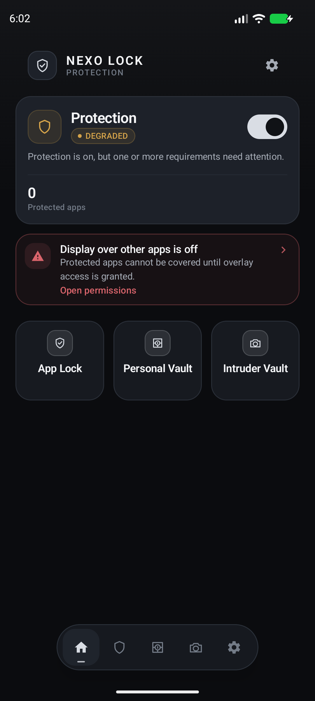
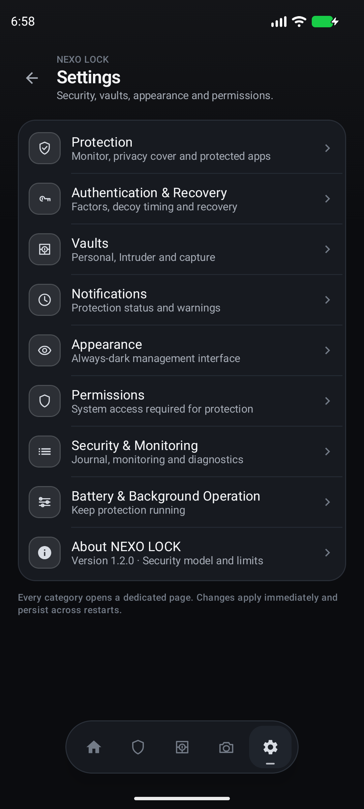
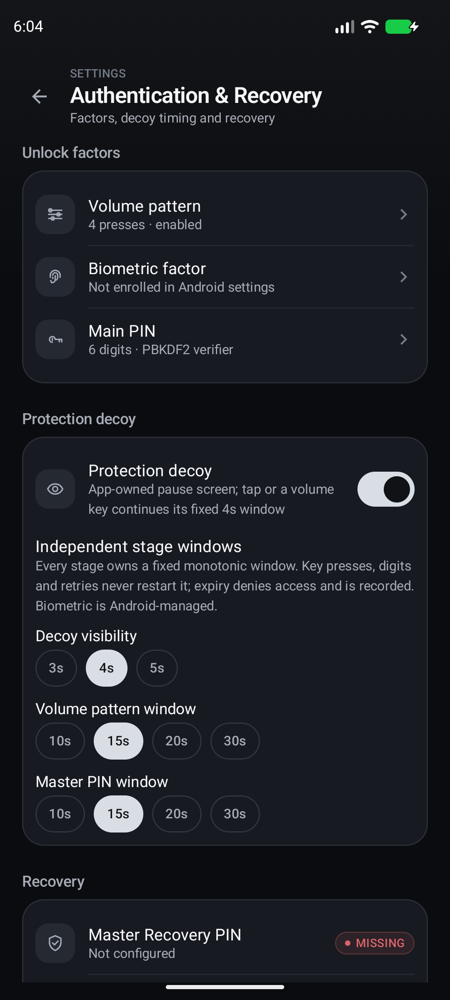

# NEXO LOCK

NEXO LOCK is a local-first Android privacy app that combines an app lock, two
independent encrypted vaults, and a tamper-evident security log. It is built with
Kotlin, Jetpack Compose, Android Keystore, and DataStore.

## Download

[**Download NEXO LOCK v1.2.0 APK**](https://github.com/vinay09930/NEXO-LOCK/releases/latest/download/NEXO_LOCK_V1.2.0_RELEASE.apk)

The APK is distributed through GitHub Releases and is **not** stored in the
source tree. No repository clone is required.

| Item | Value |
| --- | --- |
| Version | `1.2.0` (versionCode `13`) |
| Package | `com.vinay.nexolock` |
| Minimum Android | 8.0 (API 26) |
| Target / compile SDK | API 37 |
| APK size | 13.9 MB |
| SHA-256 | `80BA3BEA9F3111E410C3B19B29C44370A2C1E0C1BC4294A607971DF5E6EB3D2D` |
| Checksum | [GitHub Release asset](https://github.com/vinay09930/NEXO-LOCK/releases/latest/download/NEXO_LOCK_V1.2.0_SHA256.txt) |
| Signing certificate | `fe1d89ccfac4fb031cc3e13d79d311f88421afe69b9bdc69fecff7aedda1978c` |

This is a local, emulator-smoke-tested delivery. It is signed with the Android
debug certificate and is **not store-ready**.

## Screenshots

Captured from the V1.2.0 release build on an API 37 (Android 17) emulator.

| Home | Home with recent activity | Settings hub |
| --- | --- | --- |
|  |  |  |

| Protection | Authentication & Recovery | About |
| --- | --- | --- |
|  |  |  |

See the full set in [V1.2.0_SCREENSHOTS.md](V1.2.0_SCREENSHOTS.md).

## What is in V1.2.0

V1.2.0 is a **UI/UX-only release**. It reorganizes the management interface and
keeps the authentication, vault, protection, monitoring, storage, permission,
capture, import/export, logging, manifest, package, and decoy behaviour
unchanged.

Highlights:

- Settings is a compact **category hub** with nine entries and no detailed
  switches or diagnostics on the landing page.
- Every category opens a dedicated page with back navigation:
  - Protection;
  - Authentication & Recovery;
  - Vaults;
  - Notifications;
  - Appearance;
  - Permissions;
  - Security & Monitoring;
  - Battery & Background Operation;
  - About NEXO LOCK.
- Home is a calmer dashboard with a compact header, one primary protection
  overview, at most one prioritized actionable warning, up to three accurate
  stats, shortcuts to App Lock / Personal Vault / Intruder Vault, and an optional
  compact recent-activity preview.
- The five-tab floating navigation pill remains, with quieter elevation, surface,
  selection, and icon treatment.
- The frozen decoy lock surface is byte-for-byte unchanged.

## Documentation

| Document | Purpose |
| --- | --- |
| [PROJECT_STRUCTURE.md](PROJECT_STRUCTURE.md) | Repository layout and source packages |
| [FEATURES.md](FEATURES.md) | Complete user-facing feature guide |
| [SECURITY.md](SECURITY.md) | Cryptography, authentication, threat model |
| [PRIVACY.md](PRIVACY.md) | Data handling and network behaviour |
| [PERMISSION_SETUP.md](PERMISSION_SETUP.md) | Every permission and how to grant it |
| [INSTALL.md](INSTALL.md) | Install, upgrade, and uninstall |
| [DECOY_POLICY.md](DECOY_POLICY.md) | Frozen decoy rules and hashes |
| [KNOWN_LIMITATIONS.md](KNOWN_LIMITATIONS.md) | Honest gaps and non-goals |
| [TEST_REPORT.md](TEST_REPORT.md) | Current verification evidence |
| [CHANGELOG.md](CHANGELOG.md) | Version history known from the source |
| [TROUBLESHOOTING.md](TROUBLESHOOTING.md) | Common setup and protection issues |
| [V1.2.0_IMPLEMENTATION_REPORT.md](V1.2.0_IMPLEMENTATION_REPORT.md) | What changed in this release |
| [V1.2.0_MODIFIED_FILES.md](V1.2.0_MODIFIED_FILES.md) | Files that carry the V1.2.0 UI |
| [V1.2.0_TEST_REPORT.md](V1.2.0_TEST_REPORT.md) | Release-specific build and runtime evidence |
| [V1.2.0_RELEASE_REPORT.md](V1.2.0_RELEASE_REPORT.md) | Artifact, signing, and build report |
| [V1.2.0_SCREENSHOTS.md](V1.2.0_SCREENSHOTS.md) | Screenshot index and runtime notes |

## Verification status

Verified on 2026-11-15:

- `:app:compileDebugKotlin` - BUILD SUCCESSFUL.
- 149 JVM unit tests across 18 suites - 0 failures, 0 errors, 0 skipped.
- `:app:assembleRelease` - BUILD SUCCESSFUL.
- The release APK reports package `com.vinay.nexolock`, versionCode `13`,
  versionName `1.2.0`, and signer certificate `fe1d89cc...978c`.
- The staged APK SHA-256 digest was recomputed after copying.
- The RELEASE APK was installed over the previous same-key release and launched
  successfully; existing setup data and journal entries were preserved.
- First-run setup was completed with a volume pattern and a six-digit master PIN.
- Home, the Settings hub, all nine category pages, and the About page were opened
  and captured. Back navigation, the floating navigation pill, the Home warning
  action, and the Personal Vault shortcut were exercised.
- The three frozen decoy source files still match their pinned SHA-256 hashes.

**Not fully verified:** full unlock and lockout flows, decoy timing on device,
vault import/export, camera capture, overlay/accessibility protection against a
real protected app, physical-device upgrade migration, and multiple Android
versions/vendors. Android Lint and instrumented tests were not run. See
[KNOWN_LIMITATIONS.md](KNOWN_LIMITATIONS.md).

## Build from source

Requirements: JDK 17+ (Android Studio JBR works), Android SDK with API 37, and a
Windows or Unix shell.

```powershell
$env:JAVA_HOME = "C:\Program Files\Android\Android Studio\jbr"
cd source
.\gradlew.bat :app:testDebugUnitTest :app:assembleRelease `
  -x lintVitalRelease -x lintVitalAnalyzeRelease --no-daemon --console=plain `
  "-Dorg.gradle.jvmargs=-Xmx1408m -XX:MaxMetaspaceSize=512m -Dfile.encoding=UTF-8"
```

The release build intentionally uses the debug signing config for this local
delivery. It is installable, but it is **not store-ready**.

## Quick start

1. Download `NEXO_LOCK_V1.2.0_RELEASE.apk` from the latest GitHub Release.
2. Open the app and complete the two mandatory setup steps: volume pattern and
   master PIN.
3. Grant **Display over other apps** and at least one detection channel
   (Accessibility or Usage access). See [PERMISSION_SETUP.md](PERMISSION_SETUP.md).
4. Choose protected apps and enable protection.
5. Optionally create the Personal Vault and Intruder Vault PINs.
6. Open **Settings** and use the category hub to reach any control.

## Repository layout

```text
.
├── source/             Android Gradle project
├── screenshots/        Runtime screenshots
├── reference/          Logo source asset
├── README.md
├── CHANGELOG.md
├── FEATURES.md
├── INSTALL.md
├── SECURITY.md
├── PRIVACY.md
├── PERMISSION_SETUP.md
├── DECOY_POLICY.md
├── KNOWN_LIMITATIONS.md
├── TEST_REPORT.md
├── TROUBLESHOOTING.md
└── V1.2.0_*.md         Release-specific reports
```

The release APK and checksum are GitHub Release assets, not repository files.

## License and ownership

This is an owner-controlled local project. No open-source license is declared in
the repository. Treat the source, APKs, and documentation as owner-controlled.
