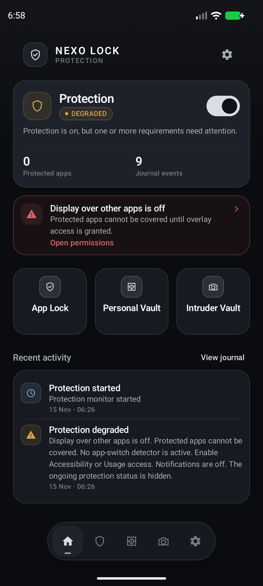
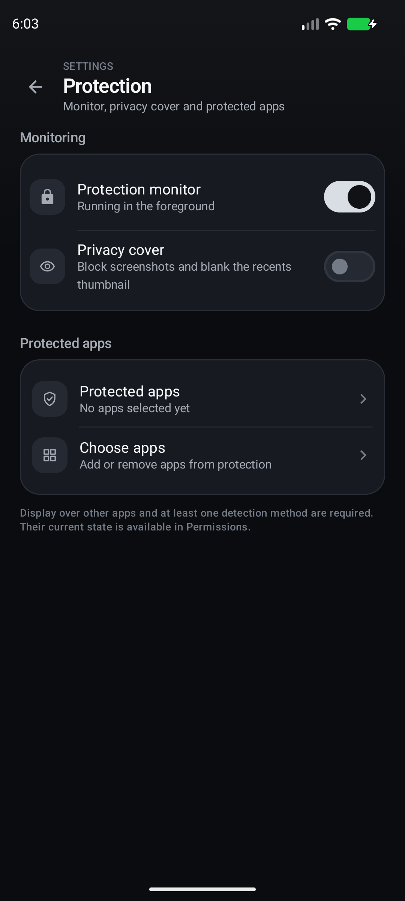
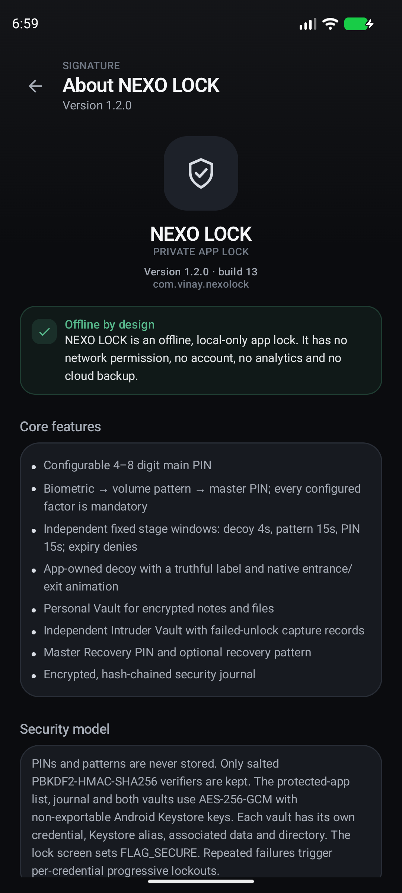

# NEXO LOCK

NEXO LOCK is a local-first Android privacy app that combines an app lock, two
independent encrypted vaults, and a tamper-evident security log. It is built with
Kotlin, Jetpack Compose, Android Keystore, and DataStore.

## Download

[**Download NEXO LOCK v1.2.0 APK**](https://github.com/vinay09930/NEXO-LOCK/releases/latest/download/NEXO_LOCK_V1.2.0_RELEASE.apk)

No repository clone is required. The APK is also stored in
[`builds/NEXO_LOCK_V1.2.0_RELEASE.apk`](builds/NEXO_LOCK_V1.2.0_RELEASE.apk).

| Item | Value |
| --- | --- |
| Version | `1.2.0` (versionCode `13`) |
| Package | `com.vinay.nexolock` |
| Minimum Android | 8.0 (API 26) |
| Target / compile SDK | API 37 |
| APK size | 13.9 MB |
| SHA-256 | `80BA3BEA9F3111E410C3B19B29C44370A2C1E0C1BC4294A607971DF5E6EB3D2D` |
| Checksum | [`builds/NEXO_LOCK_V1.2.0_SHA256.txt`](builds/NEXO_LOCK_V1.2.0_SHA256.txt) |

This is a local, emulator-smoke-tested delivery. It is signed with the Android
debug certificate and is **not store-ready**.

## Screenshots

Captured from the V1.2.0 release build on an API 37 (Android 17) emulator.

| Home | Home with recent activity | Settings hub |
| --- | --- | --- |
|  |  |  |

| Protection | Authentication & Recovery | About |
| --- | --- | --- |
|  |  |  |

See the full set in
[`documantion/V1.2.0_SCREENSHOTS.md`](documantion/V1.2.0_SCREENSHOTS.md).

## Documentation

Start with [`documantion/README.md`](documantion/README.md).

Key documents:

- [`documantion/FEATURES.md`](documantion/FEATURES.md)
- [`documantion/INSTALL.md`](documantion/INSTALL.md)
- [`documantion/SECURITY.md`](documantion/SECURITY.md)
- [`documantion/PRIVACY.md`](documantion/PRIVACY.md)
- [`documantion/KNOWN_LIMITATIONS.md`](documantion/KNOWN_LIMITATIONS.md)
- [`documantion/V1.2.0_RELEASE_REPORT.md`](documantion/V1.2.0_RELEASE_REPORT.md)
- [`documantion/V1.2.0_TEST_REPORT.md`](documantion/V1.2.0_TEST_REPORT.md)

## Build

Requirements: JDK 17+ (Android Studio JBR works), Android SDK with API 37, and a
Windows or Unix shell.

```powershell
$env:JAVA_HOME = "C:\Program Files\Android\Android Studio\jbr"
cd source
.\gradlew.bat :app:testDebugUnitTest :app:assembleRelease `
  -x lintVitalRelease -x lintVitalAnalyzeRelease --no-daemon --console=plain `
  "-Dorg.gradle.jvmargs=-Xmx1408m -XX:MaxMetaspaceSize=512m -Dfile.encoding=UTF-8"
```

## Verification status

- 149 JVM tests pass.
- The release APK builds and reports version `1.2.0` / code `13`.
- The APK installs over the previous same-key release and preserves data.
- Full unlock, lockout, decoy timing, vault I/O, camera capture, overlay
  protection, and physical-device upgrade testing remain outstanding.
- Android Lint was not run.
