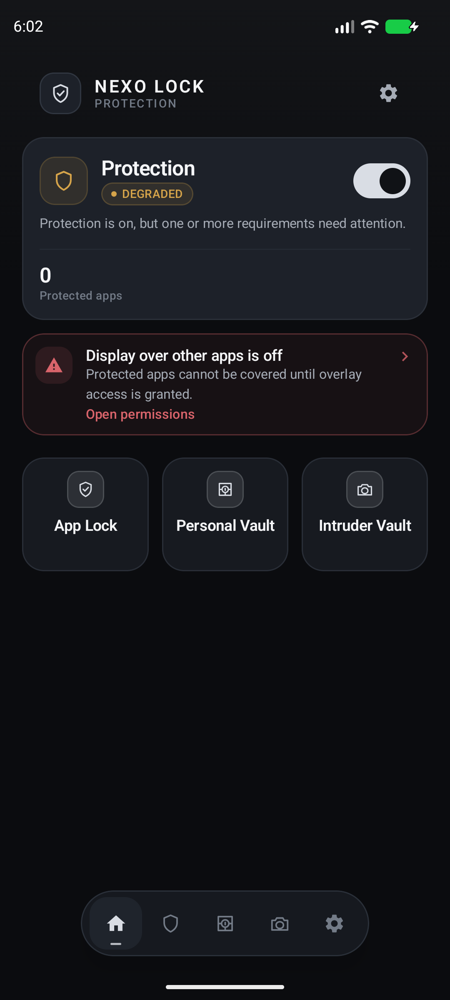
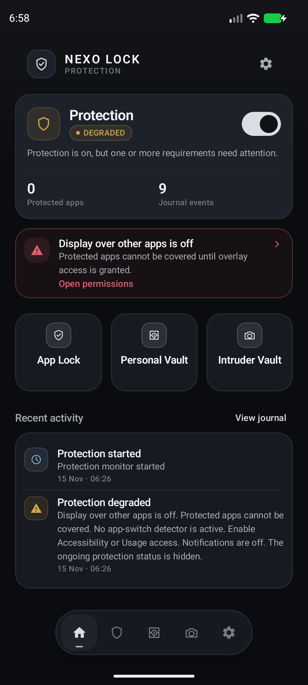
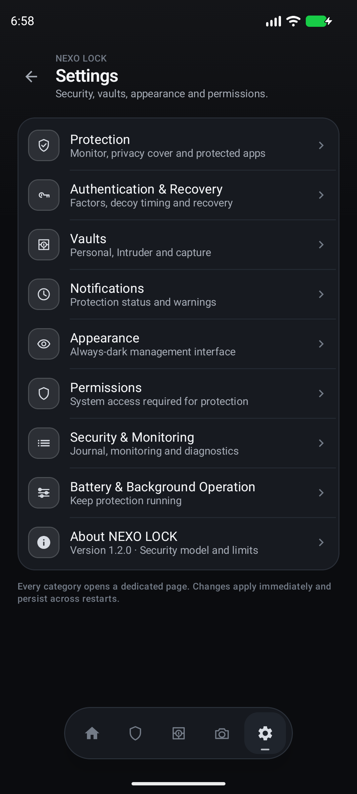

# V1.2.0 Screenshots

Runtime screenshots were captured on 2026-11-15 from the V1.2.0 RELEASE APK on a
headless API 37 (Android 17) x86_64 emulator. The profile used volume pattern
`UP, UP, DOWN, DOWN` and master PIN `135790`. The release was installed over the
previous same-key build, so the setup data and journal were preserved.

All files are in `screenshots/v1.2.0/`.

## Key screens

### Home

Compact header, one protection overview with a real `DEGRADED` state, one
actionable warning, one accurate stat (`0 Protected apps`), and three shortcuts.
Recent activity is absent because the journal was empty.

### Home with recent activity

Captured on V1.2.0 after the journal accumulated entries. Home shows two stats
and the optional compact recent-activity section. This also confirms the release
build launches and preserves existing setup data.

### Settings hub

Nine categories with summaries and chevrons. No detailed switches, timeout chips,
permission actions, or diagnostics appear on the landing page.

## Category pages

| Screenshot | Page | Notes |
| --- | --- | --- |
| [03_settings_protection.png](screenshots/v1.2.0/03_settings_protection.png) | Protection | Monitor and privacy-cover switches; protected-app count and app picker |
| [04_settings_authentication.png](screenshots/v1.2.0/04_settings_authentication.png) | Authentication & Recovery (top) | Factors, decoy switch, stage-window chips |
| [04b_settings_authentication_bottom.png](screenshots/v1.2.0/04b_settings_authentication_bottom.png) | Authentication & Recovery (bottom) | Recovery PIN and recovery pattern |
| [05_settings_vaults.png](screenshots/v1.2.0/05_settings_vaults.png) | Vaults | Personal/Intruder status and capture readiness |
| [06_settings_notifications.png](screenshots/v1.2.0/06_settings_notifications.png) | Notifications | Real `NOT GRANTED` state and open-settings action |
| [07_settings_appearance.png](screenshots/v1.2.0/07_settings_appearance.png) | Appearance | Always-dark status and compatibility note |
| [08_settings_permissions.png](screenshots/v1.2.0/08_settings_permissions.png) | Permissions (top) | Overlay, Accessibility, Usage, restricted settings |
| [08b_settings_permissions_bottom.png](screenshots/v1.2.0/08b_settings_permissions_bottom.png) | Permissions (bottom) | Notifications and battery optimization |
| [09_settings_security_monitoring.png](screenshots/v1.2.0/09_settings_security_monitoring.png) | Security & Monitoring | Monitor/detection/service status and journal |
| [10_settings_battery.png](screenshots/v1.2.0/10_settings_battery.png) | Battery & Background Operation | Battery state, open-settings action, guidance |
| [11_settings_about.png](screenshots/v1.2.0/11_settings_about.png) | About NEXO LOCK | Version `1.2.0`, build `13` |

## Runtime notes

- The Home warning "Display over other apps is off" opened the Permissions
  category.
- The floating pill switched between Home, App Lock, Personal Vault, Intruder
  Vault, and Settings.
- Back navigation returned from each detail page to the hub.
- The Personal Vault shortcut opened the secure vault route. The route applied
  `FLAG_SECURE`, so the capture was a black frame and is not included; that is
  expected and is not a missing UI capture.
- The decoy lock surface was not opened during this session. Its three source
  files remain hash-pinned and unchanged.

## Not captured

- Full unlock, lockout, and decoy timing flows.
- Vault import/export and camera capture.
- Protected-app overlay coverage against a real target app.
- Physical-device upgrade migration.
- TalkBack/large-text layouts.
